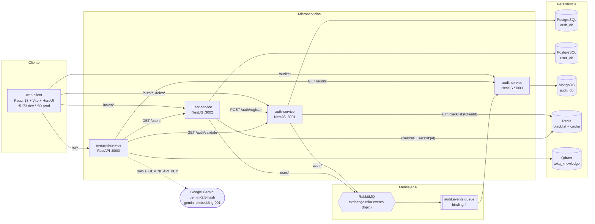
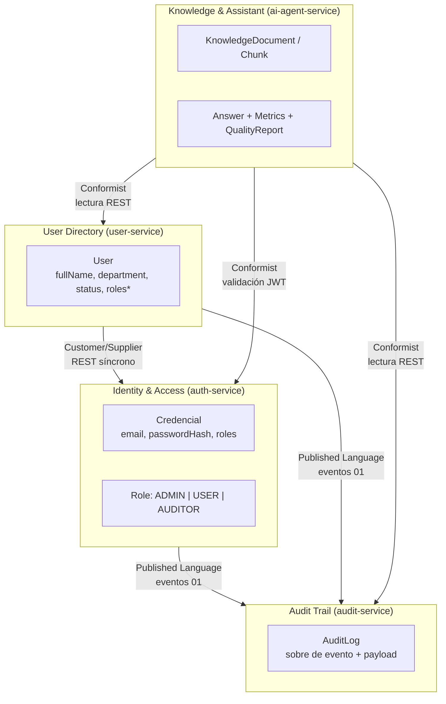
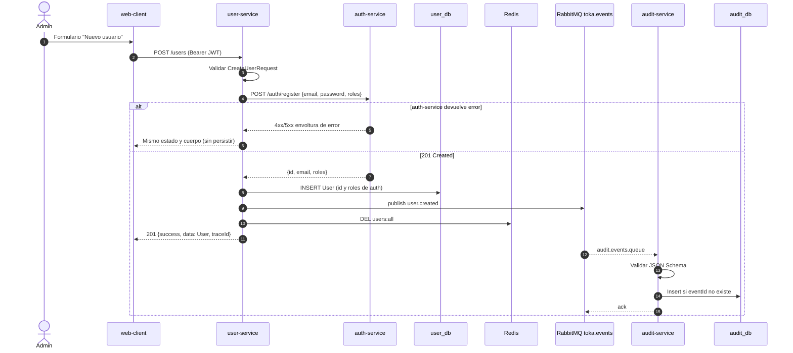
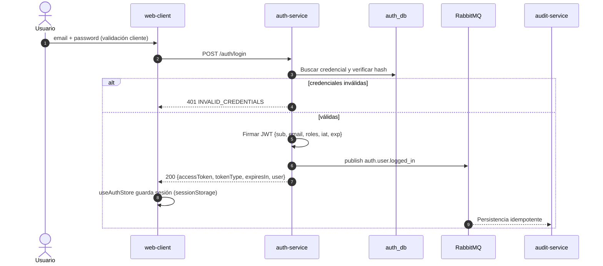
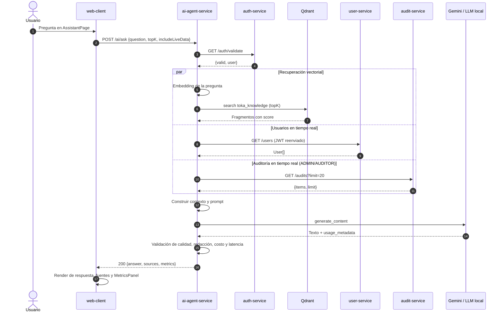
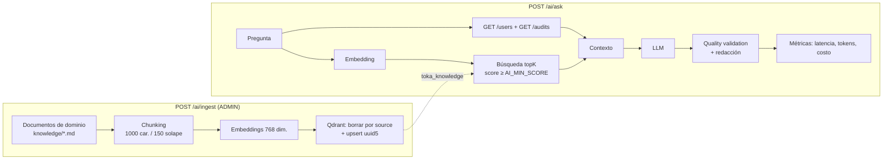
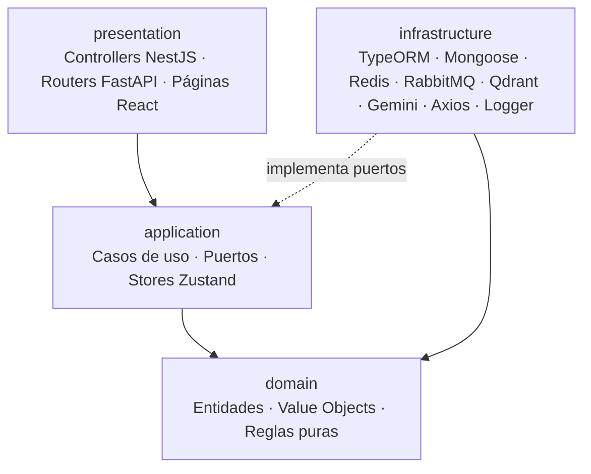

# Toka — Documento de Arquitectura (Ejercicio 1)

| Atributo | Valor |
|---|---|
| Versión | 1.0 |
| Fecha | 2026-10-21 |
| Metodología | Spec-Driven Development (SDD) |
| Fuente de verdad | `specs/00` a `specs/06` |

Este documento describe la arquitectura de la plataforma Toka. No define contratos nuevos: cada endpoint, evento, esquema o estructura citada remite a su especificación en `specs/`. Ante cualquier discrepancia, prevalece la spec.

## 1. Contexto y objetivos

Toka es una plataforma de gestión de identidades con trazabilidad completa y un asistente de IA. Sus objetivos arquitectónicos son:

1. **Autonomía por servicio**: cada microservicio es dueño de sus datos y se despliega de forma independiente.
2. **Trazabilidad**: toda acción relevante de identidad genera un evento auditable de forma asíncrona.
3. **Contratos explícitos**: respuestas HTTP, errores, logs, JWT y eventos están normalizados (`00`, `01`).
4. **Asistencia inteligente**: un agente RAG responde sobre la plataforma combinando conocimiento indexado y datos en tiempo real (`05`).
5. **Testabilidad**: DDD + Clean Architecture permiten probar dominio y casos de uso sin infraestructura.

## 2. Mapa de especificaciones

| Spec | Alcance |
|---|---|
| [`00-system-context`](../specs/00-system-context.spec.md) | Puertos, logger JSON, envolturas HTTP de éxito y error. |
| [`01-contracts-events`](../specs/01-contracts-events.spec.md) | Payload JWT, topología RabbitMQ y JSON Schemas de los 5 eventos. |
| [`02-auth-service`](../specs/02-auth-service.spec.md) | Credenciales, roles, JWT, blacklist Redis. |
| [`03-user-service`](../specs/03-user-service.spec.md) | Perfil de usuario, Cache-Aside Redis, alta orquestada con `auth-service`. |
| [`04-audit-service`](../specs/04-audit-service.spec.md) | Consumo idempotente de eventos y consulta de auditoría en MongoDB. |
| [`05-ai-agent-rag`](../specs/05-ai-agent-rag.spec.md) | Ingesta en Qdrant y consulta RAG con métricas de latencia, tokens, costo y calidad. |
| [`06-web-client`](../specs/06-web-client.spec.md) | SPA React, stores Zustand, vistas y proxy same-origin. |

## 3. Vista de componentes

| Componente | Responsabilidad | Spec |
|---|---|---|
| `auth-service` | Fuente de verdad de credenciales y roles; emite y valida JWT; publica `auth.user.logged_in` y `auth.role.assigned`. | `02` |
| `user-service` | Perfil de usuario (nombre, departamento, estado); orquesta el alta con `auth-service`; publica `user.created`, `user.updated`, `user.deleted`. | `03` |
| `audit-service` | Consume todos los eventos, los persiste de forma idempotente y expone consultas y estadísticas. | `04` |
| `ai-agent-service` | Indexa conocimiento de dominio y responde preguntas con RAG híbrido (vectorial + tiempo real). | `05` |
| `web-client` | SPA para login, gestión de usuarios y roles, auditoría y chat RAG con métricas. | `06` |

## 4. Bounded contexts (DDD)

- **Identidad compartida**: el `id` del `User` es el mismo `id` emitido por `auth-service` en el registro (`03`), lo que permite correlacionar ambos contextos sin una base compartida.
- **Proyección de roles**: `User.roles` es una proyección tomada en el alta. La autoridad de roles es `auth-service` (`03`, sección "Entidad `User`").
- **Published Language**: los JSON Schemas de `01` son el lenguaje publicado entre productores y `audit-service`.
- **Conformist**: `ai-agent-service` consume los contratos de `03` y `04` tal cual, sin capa de traducción propia.

## 5. Estrategia Multi-DB (Database per Service)

Cada servicio posee su almacenamiento y ningún otro servicio accede a él directamente. La elección de motor responde al patrón de acceso de cada contexto.

| Servicio | Motor | Base / recurso | Justificación | Spec |
|---|---|---|---|---|
| `auth-service` | PostgreSQL 16 | `auth_db` (`roles`, `auth_credentials`) | Consistencia fuerte, unicidad de email y restricciones relacionales sobre roles. | `02` |
| `auth-service` | Redis 7 | `auth:blacklist:{tokenId}` con TTL = vida restante del JWT | Consulta O(1) en cada validación y expiración automática. | `02` |
| `user-service` | PostgreSQL 16 | `user_db` | Entidad estructurada con actualizaciones parciales y unicidad de email. | `03` |
| `user-service` | Redis 7 | `users:all`, `users:id:{id}`, TTL 60 s | Cache-Aside para lecturas frecuentes; invalidación en cada escritura. | `03` |
| `audit-service` | MongoDB 7 | `audit_db.audit_logs` | Append-only, `payload` heterogéneo por tipo de evento, índices por fecha, tipo y actor. | `04` |
| `ai-agent-service` | Qdrant | Colección `toka_knowledge`, 768 dim., Cosine | Búsqueda semántica por similitud vectorial con filtrado por `source`. | `05` |

**Decisiones de despliegue local** (`docker-compose.yml`):

- Una instancia PostgreSQL con dos bases aisladas (`auth_db`, `user_db`) creadas por `infra/postgres/init.sql`. El aislamiento es lógico por base; en producción pueden separarse en instancias distintas sin cambios de código.
- Una instancia Redis compartida con espacios de claves disjuntos (`auth:*` y `users:*`).
- Todos los contenedores comparten la red `toka-network` y se resuelven por nombre de servicio (`00`).

**Consistencia entre bases**: no hay transacciones distribuidas. La creación de usuario aplica "validar remoto, luego persistir local" (sección 7.1) y la auditoría es eventualmente consistente vía RabbitMQ.

## 6. Comunicación

### 6.1 Síncrona — REST

| Origen | Destino | Endpoint | Propósito | Spec |
|---|---|---|---|---|
| `web-client` | todos | Endpoints públicos de `02`–`05` | Operación de la UI vía proxy same-origin. | `06` |
| `user-service` | `auth-service` | `POST /auth/register` | Crear la credencial antes del perfil. | `03` |
| `ai-agent-service` | `auth-service` | `GET /auth/validate` | Autenticar al solicitante. | `05` |
| `ai-agent-service` | `user-service` | `GET /users` | Contexto en tiempo real. | `05` |
| `ai-agent-service` | `audit-service` | `GET /audits?limit=20` | Contexto en tiempo real (solo `ADMIN`/`AUDITOR`). | `05` |

Reglas transversales:

- Envoltura `{ success, data, traceId }` y error `{ success, error: { code, message, details }, traceId }` (`00`).
- Autenticación `Authorization: Bearer <jwt>` con el payload de `01`; el JWT del usuario se reenvía a los servicios aguas abajo.
- Los errores remotos se propagan con el mismo estado y cuerpo cuando la spec lo exige (`03`, alta de usuario) o se degradan de forma controlada (`05`, contexto en tiempo real).

### 6.2 Asíncrona — RabbitMQ

| Elemento | Configuración (`01`) |
|---|---|
| Exchange | `toka.events`, tipo `topic`, durable. |
| Routing key | Valor de `eventType`. |
| Cola | `audit.events.queue`, durable, binding `#`. |
| Mensajes | JSON UTF-8 persistente, sobre común + `payload` por tipo. |

| Evento | Productor | Disparador |
|---|---|---|
| `auth.user.logged_in` | `auth-service` | `POST /auth/login` exitoso. |
| `auth.role.assigned` | `auth-service` | `POST /roles/assign` que cambia el estado. |
| `user.created` | `user-service` | `POST /users` exitoso. |
| `user.updated` | `user-service` | `PATCH /users/:id` exitoso. |
| `user.deleted` | `user-service` | `DELETE /users/:id` exitoso. |

**Garantías del consumidor** (`04`): validación contra JSON Schema antes de persistir; idempotencia por `eventId` (índice único); `ack` solo tras persistir o detectar duplicado; sin `ack` ante fallo de validación o persistencia.

El topic exchange con binding `#` permite añadir nuevos consumidores (por ejemplo, notificaciones) sin modificar productores.

## 7. Diagramas de secuencia

### 7.1 Alta de usuario (REST síncrono + evento asíncrono)

### 7.2 Login y auditoría

### 7.3 Consulta RAG

## 8. Integración RAG

### 8.1 Pipeline

### 8.2 Decisiones clave (`05`)

| Decisión | Detalle |
|---|---|
| RAG híbrido | Conocimiento estable en Qdrant + estado actual del sistema vía REST en cada consulta; los datos operativos nunca se indexan, evitando vectores obsoletos y duplicación de PII. |
| Seguridad por delegación | El JWT del usuario se reenvía; `user-service` y `audit-service` aplican sus propias reglas. `audit-service` solo se consulta si el rol lo permite. |
| Degradación controlada | Una dependencia en tiempo real caída omite su bloque y registra `warn`; un fallo de Qdrant o Gemini es un `500` explícito. |
| Modo local determinista | Sin `GEMINI_API_KEY` se usan `local-hash-768` (feature hashing SHA-256) y `local-extractive-v1`. Permite pruebas reproducibles y desarrollo sin costo; el modo se fija al arrancar, sin fallback silencioso. |
| Observabilidad de IA | Cada respuesta incluye `latency_ms`, `tokens`, `estimated_cost_usd` y `quality_validation` con 5 checks deterministas. |
| Reingesta idempotente | IDs `uuid5(source#chunkIndex)` y borrado previo por `source`. |

## 9. DDD + Clean Architecture

Todos los servicios, incluido el cliente web, aplican la misma estructura de 4 capas con dependencias hacia el dominio.

| Capa | Regla | Ejemplos |
|---|---|---|
| `domain/` | Sin frameworks, I/O ni SDKs. | `User` y su validación de `status`; `AuditLog`; `estimate_cost`, `validate_quality`; validadores de contraseña. |
| `application/` | Orquesta el dominio mediante puertos. | `CreateUserUseCase` (`03`), consumidor idempotente (`04`), `AskQuestionUseCase` (`05`), stores (`06`). |
| `infrastructure/` | Adaptadores que implementan puertos; no filtra tipos de framework al dominio. | Repositorios TypeORM/Mongoose, publisher RabbitMQ, `QdrantVectorStore`, `GeminiLlmProvider`, clientes Axios. |
| `presentation/` | Entrada/salida y mapeo a las envolturas de `00`. | Controllers, DTOs de validación, manejadores de excepciones, componentes HeroUI. |

**Beneficios verificables**: los casos de uso se prueban con puertos simulados (Jest en NestJS y web, `pytest` en Python) y la cobertura objetivo de dominio y aplicación es superior a 75% en todas las specs.

## 10. Atributos transversales

| Atributo | Mecanismo | Spec |
|---|---|---|
| Logging | Una línea JSON por evento: `timestamp`, `level`, `service`, `traceId`, `message`, `context`. Sin `console.log` ni `print`; nunca credenciales ni JWT. | `00` |
| Trazabilidad | `traceId` en cada respuesta y log, propagado entre servicios. | `00`, `05`, `06` |
| Seguridad | Contraseñas solo como hash; JWT con roles; blacklist Redis; RBAC por endpoint; sin stack traces en errores; redacción de secretos en respuestas de IA. | `00`, `02`, `05` |
| Rendimiento | Cache-Aside en `user-service`; índices compuestos en MongoDB; llamadas RAG en paralelo. | `03`, `04`, `05` |
| Resiliencia | Mensajes persistentes y colas durables; consumidor idempotente; timeouts configurables y degradación en el agente. | `01`, `04`, `05` |
| Calidad | TDD guiado por los criterios de aceptación de cada spec; cobertura superior a 75%. | `02`–`06` |

## 11. Riesgos y puntos abiertos

| Punto | Impacto | Acción propuesta |
|---|---|---|
| `00` no define el header de propagación de `traceId`. | Trazabilidad entre servicios inconsistente. | Ratificar `X-Trace-Id` en `00` (supuesto ya usado en `05` y `06`). |
| `02` no expone endpoint de revocación (logout). | La blacklist Redis no tiene productor desde el cliente; el logout es local. | Definir `POST /auth/logout` en `02` si se requiere revocación activa. |
| `User.roles` es una proyección del alta. | Tras `POST /roles/assign`, `GET /users` muestra roles desactualizados. | Opcional: hacer que `user-service` consuma `auth.role.assigned` (requiere actualizar `01` y `03`). |
| Alta de usuario sin compensación. | Si `user_db` falla después del registro en `auth-service`, queda una credencial sin perfil. | Evaluar saga con compensación o reintento idempotente. |
| Mensajes no confirmados en `audit-service`. | Un evento inválido puede reentregarse indefinidamente. | Definir dead-letter exchange en `01`. |
| Precios de Gemini configurables. | El costo estimado puede desviarse de la tarifa real. | Revisar `GEMINI_PRICE_*` antes de producción. |
