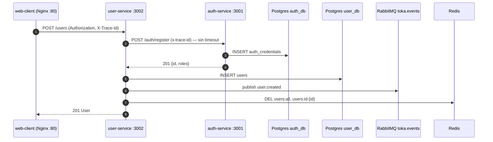
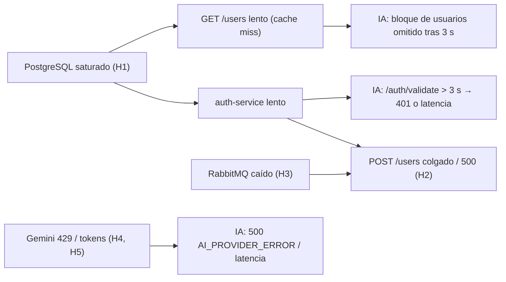
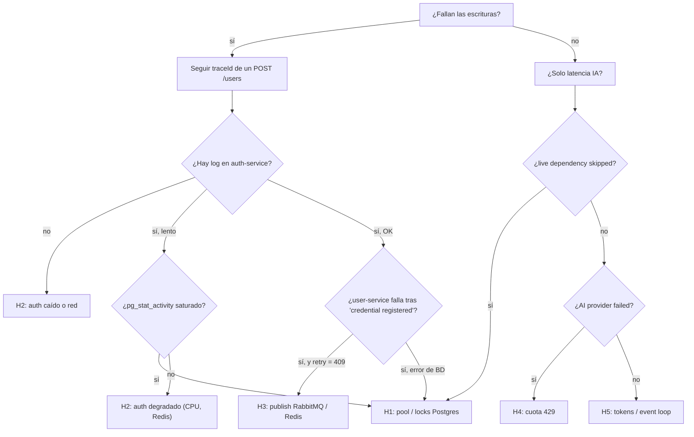
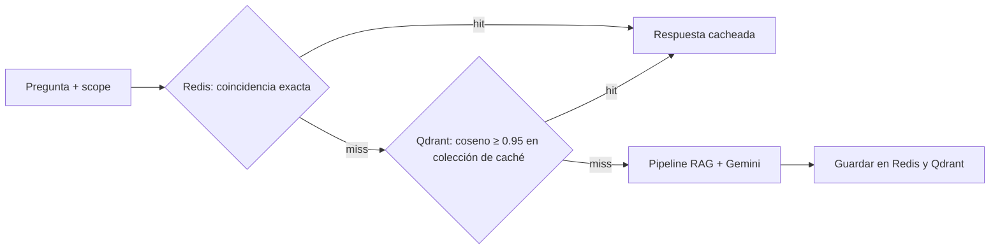

# Toka — Respuesta a incidentes (Ejercicio 4)

| Atributo | Valor |
|---|---|
| Versión | 1.0 |
| Fecha | 2026-10-21 |
| Fuente de verdad | `specs/00` a `specs/06` y el código de `apps/` |
| Severidad propuesta | **SEV-1** (pérdida de una función de escritura central para todos los usuarios) |

> **Escenario.** "Los usuarios no pueden guardar registros, algunos microservicios responden con errores 500 y hay reportes de alta latencia en las respuestas de agentes de IA."

Este documento no define contratos nuevos. Cada endpoint, evento, campo de log o variable citada remite a su spec. Las mejoras que requieren cambiar un contrato se marcan como **[requiere cambio de spec]** y, siguiendo SDD, no se implementan hasta actualizar la spec correspondiente.

---

## 1. Traducción de síntomas a componentes

| Síntoma reportado | Operaciones afectadas (contrato) | Cadena de dependencias |
|---|---|---|
| "No pueden guardar registros" | `POST /users`, `PATCH /users/:id`, `DELETE /users/:id` (`03`); `POST /auth/register`, `POST /roles/assign` (`02`). | `web-client` → Nginx → `user-service` → `auth-service` (síncrono) → PostgreSQL (`auth_db`, `user_db`) → RabbitMQ (`toka.events`) → Redis (invalidación). |
| "Errores 500" | Cualquier endpoint: `500 INTERNAL_ERROR` (`00`), `500 AI_PROVIDER_ERROR` / `500 VECTOR_STORE_ERROR` (`05`). | Depende del servicio; se identifica con `service` + `context.code` del log `request failed`. |
| "Alta latencia en IA" | `POST /ai/ask` (`05`). | `ai-agent-service` → `auth-service` (`GET /auth/validate`) → Qdrant + `user-service` (`GET /users`) + `audit-service` (`GET /audits?limit=20`) → Gemini. |

### Camino crítico de una escritura (`POST /users`)

Este es el flujo real de `CreateUserUseCase` (`03`, sección "Flujo") tal como está implementado:



Observaciones del código que condicionan el diagnóstico:

1. **Sin timeout hacia `auth-service`.** `FetchAuthRegistrar` (`apps/user-service/src/infrastructure/http/fetch-auth-registrar.ts`) usa `fetch` sin `AbortSignal`. Si `auth-service` se degrada, cada `POST /users` queda colgado hasta que el cliente (Axios, `timeout: 20000` según `06`) aborta.
2. **Persistir y luego publicar.** El usuario se guarda en `user_db` (paso 5) *antes* de publicar `user.created` (paso 6). Si RabbitMQ falla, la API responde `500` aunque el registro ya existe; el reintento del usuario termina en `409 EMAIL_ALREADY_REGISTERED`. Desde fuera parece "no puedo guardar".
3. **Sin reconexión al broker.** `RabbitMqEventBus` (`packages/shared/src/infrastructure/rabbitmq-client.ts`) abre un único canal en el arranque y no se reconecta. Tras un corte, toda escritura falla hasta reiniciar el contenedor, y `audit-service` deja de consumir `audit.events.queue`.
4. **Cache-Aside no tolerante a fallos.** En `GetUsersUseCase` un error de Redis termina en `500 INTERNAL_ERROR` en lugar de leer de PostgreSQL. En `auth-service`, ioredis está configurado con `maxRetriesPerRequest: 1`, por lo que `GET /auth/validate` (consulta de blacklist) falla rápido con `500`.
5. **Pool de PostgreSQL por defecto.** Ni `auth-service` ni `user-service` configuran `poolSize`/`extra.max` en TypeORM: cada proceso usa el máximo por defecto del driver `pg` (10 conexiones), sobre **una sola instancia** PostgreSQL que aloja `auth_db` y `user_db`.
6. **Gemini bloquea el event loop.** `GeminiLlmProvider.generate` y `GeminiEmbeddingProvider.embed` llaman al SDK **síncrono** (`client.models.generate_content` / `embed_content`) dentro de funciones `async`. Mientras Gemini responde, el worker de Uvicorn no atiende otras solicitudes, y el `asyncio.gather` del pipeline (`05`, paso 2) deja de ser paralelo en la parte de embeddings.
7. **`AI_LLM_TIMEOUT_MS` no se aplica.** `Settings` declara `ai_llm_timeout_ms = 15000` (`05`, "Configuración"), pero la llamada a Gemini no lo usa: una respuesta lenta del proveedor no tiene tope.

Los puntos 6 y 7 son desviaciones respecto de `05` y quedan registrados como acciones correctivas (sección 7).

---

## 2. Hipótesis priorizadas

La prioridad combina **probabilidad** (síntomas que explica + evidencia en el código), **radio de impacto** y **costo de verificación**. Las cinco se verifican en paralelo durante los primeros 15 minutos porque cada comprobación cuesta minutos; el orden indica qué mitigar primero si varias se confirman.

| # | Hipótesis | Síntomas que explica | Prioridad | Firma discriminante |
|---:|---|---|:---:|---|
| H1 | Agotamiento del pool / saturación de PostgreSQL | Escrituras + 500 en `auth-service` y `user-service` + latencia IA (indirecta) | **P1** | Las lecturas en *cache miss* también fallan o se vuelven lentas; `pg_stat_activity` cerca de `max_connections` o muchas sesiones `idle in transaction` / esperando locks. |
| H2 | Fallo síncrono `user-service` → `auth-service` | "No puedo guardar" (alta de usuarios) + latencia IA (validación JWT) | **P1** | `POST /users` lento o con `500`; `auth-service` sin log `credential registered` para el mismo `traceId`; IA devuelve `401 TOKEN_INVALID_OR_REVOKED` con tokens válidos. |
| H3 | Desconexión de RabbitMQ o Redis | Escrituras con `500` mientras las lecturas cacheadas funcionan | **P1** | Escritura persistida en `user_db` pero respuesta `500`; reintentos devuelven `409`; `audit.events.queue` con `consumers = 0` o mensajes acumulándose. |
| H4 | Rate limiting `429` de Gemini API | `500 AI_PROVIDER_ERROR` intermitentes en `/ai/ask` | **P2** | Logs `AI provider failed` con `context.dependency = "gemini"`; ocurren en ráfagas correlacionadas con volumen. El `429` no se propaga: `05` mapea todo fallo de Gemini a `500`. |
| H5 | Exceso de tokens en Gemini (prompts largos, *thinking*) | Latencia alta y costo creciente en `/ai/ask` | **P2** | `context.latencyMs` correlaciona con `context.totalTokens`; `metrics.tokens.total_tokens` mayor que `prompt_tokens + completion_tokens`. |

### H1 — Agotamiento del pool de conexiones de PostgreSQL

- **Mecanismo.** Cada servicio tiene un pool de 10 conexiones. Una consulta lenta, un lock sobre `auth_credentials`/`users` o una ráfaga de altas ocupa el pool; las nuevas solicitudes esperan una conexión hasta fallar. Al ser una instancia compartida, `auth-service` y `user-service` se degradan a la vez, y por eso hay 500 "en algunos microservicios".
- **Efecto en IA.** `GET /users` (contexto en tiempo real de `05`) en *cache miss* consulta PostgreSQL. Si tarda más de `AI_HTTP_TIMEOUT_MS` (3000 ms), el bloque se omite con un `warn`, pero la solicitud ya pagó hasta 3 s de espera.
- **Evidencia esperada en logs.** `level = "error"`, `message = "internal error"`, `context.errorName` con errores del driver/TypeORM (por ejemplo `QueryFailedError` o errores de timeout de conexión), seguidos de `message = "request failed"` con `context.code = "INTERNAL_ERROR"` y `context.status = 500`.
- **Confirmación.** Consultas sobre `pg_stat_activity` (sección 3.4).

### H2 — Fallo síncrono `user-service` → `auth-service`

- **Mecanismo.** `03` exige llamar síncronamente a `POST http://auth-service:3001/auth/register` antes de persistir. Sin timeout, un `auth-service` lento retiene la solicitud de `user-service` indefinidamente; un `auth-service` caído produce un error de red que termina en `500 INTERNAL_ERROR` (`context.errorName` del fallo de `fetch`, o `UnexpectedAuthResponse` si la respuesta no cumple la envoltura de `00`).
- **Riesgo de inconsistencia.** Si `auth-service` registra la credencial pero `user-service` falla después (pasos 5–6), queda una credencial **huérfana** sin perfil, y todo reintento devuelve `409 EMAIL_ALREADY_REGISTERED`.
- **Efecto en IA.** `ai-agent-service` valida cada JWT con `GET /auth/validate` (`05`, "Autenticación"). Un timeout o error de red produce `401 TOKEN_INVALID_OR_REVOKED`: el usuario ve "sesión inválida" y el `web-client` ejecuta `logout()` (`06`).
- **Confirmación.** Seguir el mismo `traceId` en `user-service` y `auth-service` (sección 3.2): debe aparecer `credential registered` o `registration rejected` en `auth-service` antes de `user created` en `user-service`.

### H3 — Desconexión de RabbitMQ o Redis

- **RabbitMQ.** El cliente no se reconecta (observación 3). Tras un reinicio del broker, una alarma de memoria/disco (que bloquea a los publishers) o un corte de red, toda operación que publica eventos (`user.created`, `user.updated`, `user.deleted`, `auth.user.logged_in`, `auth.role.assigned`) responde `500` **después** de escribir en PostgreSQL. Encaja con "no puedo guardar" mientras las lecturas siguen funcionando. Si `audit-service` también perdió el canal, la auditoría se detiene en silencio.
- **Redis.** Si Redis no responde, `GET /users` y `GET /users/:id` fallan con `500` (Cache-Aside no tolerante), la invalidación posterior a una escritura falla tras persistir, y `GET /auth/validate` falla al consultar la blacklist `auth:blacklist:{tokenId}`, lo que arrastra a `ai-agent-service`.
- **Confirmación.** Estado del broker y de la cola `audit.events.queue`, y `redis-cli` (secciones 3.4 y 3.5).

### H4 — Rate limiting (`429`) de Gemini API

- **Mecanismo.** Al superar la cuota de solicitudes o tokens por minuto, Gemini devuelve `429 RESOURCE_EXHAUSTED`. Por contrato (`05`, "Proveedores") no hay fallback silencioso: la solicitud falla con `500 AI_PROVIDER_ERROR`. Los reintentos manuales de los usuarios amplifican el problema (tormenta de reintentos).
- **Agravante.** `POST /ai/ingest` con hasta 50 documentos de 100 000 caracteres genera muchas llamadas de embeddings que compiten por la misma cuota.
- **Evidencia esperada.** `level = "error"`, `message = "AI provider failed"`, `context.dependency = "gemini"`, `context.errorType = "AIProviderError"`. El tipo concreto del SDK no se registra (solo `errorType`), así que confirmar el `429` exige revisar la consola de cuotas de Google AI Studio / Cloud.

### H5 — Exceso de tokens en Gemini

- **Tamaño del prompt.** Con los límites de `05`, el peor caso es: `topK = 10` fragmentos de hasta 1 000 caracteres, 50 líneas de usuarios, 20 de auditoría y una pregunta de 2 000 caracteres. Son unos 20 000 caracteres, es decir unos 5 000 tokens de entrada (estimación `len / 4` de `05`).
- **Tokens de razonamiento.** `gemini-2.5-flash` razona ("thinking") por defecto y la configuración de `05` no fija un presupuesto. Esos tokens aumentan la latencia y se facturan como salida, pero no entran en `candidates_token_count`. Firma en nuestras métricas: `total_tokens > prompt_tokens + completion_tokens`. **Consecuencia:** `estimated_cost_usd` (calculado sobre `prompt_tokens` y `completion_tokens`) subestima el costo real. Debe verificarse contra `usage_metadata.thoughts_token_count`.
- **Amplificador.** Por la observación 6, una llamada lenta a Gemini bloquea el event loop: la latencia de una solicitud se suma a la de todas las que están en cola en el mismo worker.

### Hipótesis unificadora (cascada)

Los tres síntomas pueden tener una sola causa raíz:



Por eso el diagnóstico empieza por la capa de datos compartida y sigue el `traceId` de extremo a extremo antes de concluir que son incidentes independientes.

---

## 3. Plan de diagnóstico sistemático

### 3.0 Campos de log disponibles (contrato real)

Todos los servicios emiten una línea JSON por evento con la estructura de `00`:

| Campo | Uso en el diagnóstico |
|---|---|
| `timestamp` | Orden temporal y cálculo de duración entre logs del mismo `traceId`. |
| `level` | `error` = fallo `5xx` o dependencia caída; `warn` = rechazo `4xx` o dependencia en tiempo real omitida. |
| `service` | `auth-service`, `user-service`, `audit-service`, `ai-agent-service`, `web-client`. |
| `traceId` | Correlación de extremo a extremo; se propaga en el header `X-Trace-Id` (supuesto de `05`/`06`, implementado en todos los servicios). |
| `message` | Mensajes estables, por ejemplo `request failed`, `internal error`, `user created`, `question answered`, `live dependency skipped`, `AI provider failed`. |
| `context` | `code`, `status`, `errorName` (NestJS); `dependency`, `status`, `errorType`, `latencyMs`, `totalTokens`, `estimatedCostUsd`, `qualityPassed`, `mode` (IA). |

**Sobre la latencia.** El logger de `00` **no** tiene un campo de primer nivel `latency_ms`. La latencia existe en dos lugares definidos por `05`:

- `metrics.latency_ms` en el cuerpo de respuesta de `POST /ai/ask`.
- `context.latencyMs` en el log `info` `question answered` de `ai-agent-service`.

Los servicios NestJS no registran la duración de cada solicitud; su latencia se obtiene restando `timestamp` entre logs del mismo `traceId` o desde Nginx. Añadir `context.latencyMs` al log de cada solicitud HTTP es una acción correctiva **[requiere cambio de spec en `00`]**.

> Los comandos usan `jq -R 'fromjson? // empty'` para ignorar líneas que no sean JSON (por ejemplo, logs de acceso de Uvicorn o Nginx).

### 3.1 Fase 0 — Triage (0–5 min)

```bash
# Estado y healthchecks de todos los contenedores
docker compose ps

# Reinicios recientes u OOM kills
docker inspect --format '{{.Name}} restarts={{.RestartCount}} oom={{.State.OOMKilled}}' $(docker compose ps -q)

# Consumo de CPU/memoria
docker stats --no-stream
```

Reproducir el síntoma con un `traceId` conocido, a través del mismo origen que usa el navegador:

```bash
TOKEN=$(curl -s localhost/auth/login -H 'content-type: application/json' \
  -d '{"email":"admin@toka.com","password":"Admin123!"}' | jq -r .data.accessToken)

curl -s -w '\nstatus=%{http_code} total=%{time_total}s\n' localhost/users \
  -H "Authorization: Bearer $TOKEN" -H 'X-Trace-Id: trc_incident_write_01' \
  -H 'content-type: application/json' \
  -d '{"email":"probe01@toka.com","password":"Probe123!","fullName":"Probe","department":"SRE"}'
```

### 3.2 Fase 1 — Localizar el servicio que falla (5–15 min)

**Distribución de errores por servicio y causa:**

```bash
docker compose logs --no-log-prefix --since 30m auth-service user-service audit-service ai-agent-service \
  | jq -rR 'fromjson? // empty | select(.level=="error")
      | [.service, .message, (.context.code // .context.errorName // .context.errorType // "-")] | @tsv' \
  | sort | uniq -c | sort -rn
```

**Seguir una solicitud de extremo a extremo** (la que falló en el triage o un `traceId` reportado por soporte):

```bash
docker compose logs --no-log-prefix --since 30m auth-service user-service audit-service ai-agent-service \
  | jq -cR --arg t trc_incident_write_01 'fromjson? // empty | select(.traceId==$t)
      | {timestamp, service, level, message, context}' \
  | sort
```

Lectura esperada para un alta sana: `auth-service · credential registered` → `user-service · user created`. Interpretación:

| Patrón observado | Hipótesis |
|---|---|
| No aparece ningún log de `auth-service` y `user-service` termina en `internal error` | H2 (auth caído o red) |
| Gran diferencia de `timestamp` entre el inicio y `credential registered` | H1 o H2 (auth lento) |
| `credential registered` presente, luego `internal error` en `user-service` | H1 (`user_db`) o H3 (publish/Redis) |
| Reintento posterior con `context.code = "EMAIL_ALREADY_REGISTERED"` | Confirma persistencia parcial (H3 o credencial huérfana de H2) |

**Rechazos `4xx` frente a fallos `5xx`** (separa errores de usuario de fallos de plataforma):

```bash
docker compose logs --no-log-prefix --since 30m user-service auth-service \
  | jq -rR 'fromjson? // empty | select(.message=="request failed" or .message=="request rejected")
      | [.service, (.context.status|tostring), .context.code] | @tsv' \
  | sort | uniq -c | sort -rn
```

### 3.3 Fase 2 — Latencia del agente de IA

**Percentiles de `context.latencyMs` y su relación con tokens:**

```bash
docker compose logs --no-log-prefix --since 30m ai-agent-service \
  | jq -sR '[split("\n")[] | fromjson? // empty | select(.message=="question answered") | .context]
      | sort_by(.latencyMs)
      | {n: length,
         p50: .[(length*0.50|floor)].latencyMs,
         p95: .[(length*0.95|floor)].latencyMs,
         max: (.[-1].latencyMs),
         avgTokens: (map(.totalTokens)|add/length),
         costUsd: (map(.estimatedCostUsd)|add),
         modes: (group_by(.mode)|map({(.[0].mode): length})|add)}'
```

**Dependencias en tiempo real omitidas** (`user-service`, `audit-service`) y fallos de proveedores:

```bash
docker compose logs --no-log-prefix --since 30m ai-agent-service \
  | jq -rR 'fromjson? // empty
      | select(.message=="live dependency skipped" or .message=="AI provider failed" or .message=="vector store failed")
      | [.level, .message, .context.dependency, (.context.status // .context.errorType | tostring)] | @tsv' \
  | sort | uniq -c | sort -rn
```

| Señal | Interpretación |
|---|---|
| `latencyMs` alto con `totalTokens` alto | H5 (prompt/thinking). |
| `latencyMs` ≈ 3000 + resto, con `live dependency skipped` | Dependencia en tiempo real lenta: volver a H1/H2. |
| `latencyMs` alto con pocos tokens y concurrencia alta | Bloqueo del event loop (observación 6). |
| `AI provider failed` en ráfagas | H4 (cuota) o caída del proveedor. |
| `mode = "local"` inesperado | `GEMINI_API_KEY` vacía en el contenedor (configuración). |

Medición de una sola pregunta desde fuera, usando el campo contractual:

```bash
curl -s localhost/ai/ask -H "Authorization: Bearer $TOKEN" -H 'X-Trace-Id: trc_incident_ai_01' \
  -H 'content-type: application/json' -d '{"question":"¿Qué roles existen?","includeLiveData":true}' \
  | jq '.data.metrics | {latency_ms, tokens, estimated_cost_usd}'
```

### 3.4 Fase 3 — Capa de datos y mensajería

**PostgreSQL (H1):**

```bash
docker compose exec postgres psql -U toka -d postgres -c "SHOW max_connections;"

docker compose exec postgres psql -U toka -d postgres -c "
  SELECT datname, state, wait_event_type, count(*)
  FROM pg_stat_activity WHERE datname IN ('auth_db','user_db')
  GROUP BY 1,2,3 ORDER BY 4 DESC;"

docker compose exec postgres psql -U toka -d postgres -c "
  SELECT pid, datname, state, now()-query_start AS age, left(query,80) AS query
  FROM pg_stat_activity WHERE state <> 'idle' ORDER BY age DESC LIMIT 10;"

docker compose exec postgres psql -U toka -d postgres -c "
  SELECT pid, pg_blocking_pids(pid) AS blocked_by, left(query,80)
  FROM pg_stat_activity WHERE cardinality(pg_blocking_pids(pid)) > 0;"
```

Confirmado si hay cerca de 10 conexiones activas por servicio, sesiones `idle in transaction` antiguas, `wait_event_type = 'Lock'` o consultas con `age` de segundos.

**RabbitMQ (H3):**

```bash
docker compose exec rabbitmq rabbitmq-diagnostics -q status | grep -iA3 alarm
docker compose exec rabbitmq rabbitmqctl list_connections name state
docker compose exec rabbitmq rabbitmqctl list_queues name messages consumers
```

Confirmado si hay alarmas activas, conexiones `blocked`/`blocking`, faltan conexiones de `auth-service`/`user-service`, o `audit.events.queue` tiene `consumers = 0` o `messages` creciente.

**Redis (H3):**

```bash
docker compose exec redis redis-cli ping
docker compose exec redis redis-cli info clients | grep -E 'connected_clients|blocked_clients'
docker compose exec redis redis-cli info stats | grep -E 'rejected_connections|evicted_keys'
docker compose exec redis redis-cli --latency -i 1   # Ctrl+C tras unos segundos
```

**Qdrant (afecta `/ai/ask` con `500 VECTOR_STORE_ERROR`):**

```bash
docker compose exec ai-agent-service python -c \
  "import httpx; print(httpx.get('http://qdrant:6333/collections/toka_knowledge').json()['result']['status'])"
```

### 3.5 Fase 4 — Proveedor externo (H4, H5)

1. Revisar la consola de cuotas de Gemini (RPM, TPM, RPD) del proyecto asociado a `GEMINI_API_KEY` y buscar picos de `429`.
2. Comparar `metrics.tokens.total_tokens` con `prompt_tokens + completion_tokens` en una muestra de respuestas: la diferencia son tokens de razonamiento no costeados.
3. Revisar si hubo ingestas grandes (`knowledge ingestion completed`, `context.chunksIndexed`) en la ventana del incidente.

### 3.6 Árbol de decisión



---

## 4. Mitigación inmediata (contención)

Objetivo: restaurar la escritura en menos de 30 minutos, aunque sea con capacidad degradada.

| Hipótesis confirmada | Acción inmediata | Riesgo |
|---|---|---|
| H1 | Terminar las sesiones bloqueantes (`SELECT pg_terminate_backend(pid)` sobre `idle in transaction` antiguas); reiniciar escalonadamente `user-service` y `auth-service` para liberar pools; pausar ingestas y tráfico no esencial. | Reiniciar sin liberar el lock reproduce el problema. |
| H2 | Restaurar o reiniciar `auth-service`; si está sano pero lento, revisar Redis/Postgres (su dependencia). Inventariar credenciales huérfanas: `auth_credentials.id` sin `users.id` (bases distintas, se cruzan por script). | Credenciales huérfanas bloquean el reintento con `409`. |
| H3 (RabbitMQ) | Resolver alarmas del broker (espacio en disco/memoria) y **reiniciar** `auth-service`, `user-service` y `audit-service`, porque el cliente no se reconecta. Verificar `consumers = 1` en `audit.events.queue`. | Los eventos de escrituras que fallaron tras persistir no se publicaron: hay hueco de auditoría que reconciliar. |
| H3 (Redis) | Restaurar Redis; reiniciar los servicios si ioredis no recupera la conexión. | La caché vacía genera un pico de lecturas a Postgres (efecto estampida); escalonar el tráfico. |
| H4 | Pausar `POST /ai/ingest`; comunicar degradación del asistente; solicitar aumento de cuota o activar facturación de un nivel superior. | — |
| H5 | Sugerir `includeLiveData: false` y `topK` bajo desde soporte para consultas generales; escalar réplicas de `ai-agent-service` para paliar el bloqueo del event loop. | Menos contexto puede reducir la calidad (`quality_validation`). |

**Reconciliación posterior.** Para la ventana del incidente, comparar `users` (`user_db`) con `audit_logs` (`audit_db`, `eventType = user.created`) y con `auth_credentials` (`auth_db`) para detectar perfiles sin evento y credenciales sin perfil.

---

## 5. Mitigación de latencia y costos de IA

Las tres medidas cambian el comportamiento de `05` y son **[requiere cambio de spec]**. Se proponen aquí como diseño; se implementan solo tras ampliar `specs/05-ai-agent-rag.spec.md` (configuración, criterios de aceptación y, si aplica, contrato de respuesta).

### 5.1 Semantic Caching (Redis + Qdrant)

Evita llamar a Gemini cuando ya se respondió una pregunta equivalente.



| Decisión | Propuesta | Motivo |
|---|---|---|
| Capa 1 (exacta) | Redis, clave `ai:cache:{sha256(scope + pregunta normalizada)}`. | Coste casi nulo; reutiliza la normalización de `normalize_tokens` (`05`). |
| Capa 2 (semántica) | Colección Qdrant dedicada (separada de `toka_knowledge`), con el embedding de la pregunta ya calculado en el paso 2 del pipeline. | La búsqueda vectorial ya se paga; no añade llamadas a Gemini. |
| *Scope* de la clave | Roles del solicitante + `includeLiveData` + `topK`. | **Seguridad:** solo `ADMIN`/`AUDITOR` reciben el bloque de auditoría (`05`, paso 2). Sin el rol en la clave, un `USER` podría recibir una respuesta con datos de auditoría. |
| TTL | 60 s si `includeLiveData = true` (igual que `users:all` en `03`); 24 h si solo hay conocimiento estático; invalidar al reingestar un `source`. | Evita servir datos en tiempo real obsoletos. |
| Umbral | Coseno ≥ 0.95, calibrado con un conjunto de preguntas parafraseadas. | Un umbral bajo devuelve respuestas a preguntas distintas. |
| Métricas | En un *hit*, `latency_ms` refleja el tiempo real y `tokens`/`estimated_cost_usd` valen `0`. | `05` fija las claves exactas de `metrics`; indicar el *hit* (p. ej. `cache_hit`) exige ampliar el contrato. |

Impacto esperado: con preguntas repetitivas (FAQ de roles y políticas), la tasa de *hit* puede reducir llamadas al LLM de forma significativa. El número real se mide durante la prueba piloto con el log `question answered`.

### 5.2 Poda de la ventana de contexto

| Técnica | Propuesta | Ahorro |
|---|---|---|
| Presupuesto de tokens | Tope de contexto (p. ej. 3 000 tokens estimados con `len / 4`); se agregan bloques por relevancia hasta agotarlo. | Acota el peor caso de ~5 000 tokens de entrada. |
| `topK` efectivo | Default 3 en lugar de 5 y descarte por `AI_MIN_SCORE` más estricto. | Menos fragmentos marginales. |
| Datos en tiempo real dirigidos | Filtrar el bloque de usuarios por términos de la pregunta (departamento, estado, email) en lugar de las 50 primeras filas; reducir auditoría a 10 líneas. | El bloque de usuarios es la parte más grande del prompt. |
| Deduplicación | Fusionar fragmentos solapados (los chunks comparten 150 caracteres). | Elimina texto repetido. |
| Razonamiento | Fijar `thinking_budget` bajo o `0` para `gemini-2.5-flash` y contabilizar los tokens de razonamiento en el costo. | Reduce latencia y corrige la subestimación de `estimated_cost_usd`. |

### 5.3 Circuit Breaker, timeouts y control de concurrencia

| Punto de integración | Política propuesta | Comportamiento con el circuito abierto |
|---|---|---|
| Gemini (`ai-agent-service`) | Abrir tras 5 fallos o `429` en 30 s; semiabierto tras 30 s con 1 solicitud de prueba. Aplicar `AI_LLM_TIMEOUT_MS`. Reintento único con backoff exponencial + jitter solo para `429`, respetando `Retry-After`. | Responder de inmediato `500 AI_PROVIDER_ERROR`, **sin** caer al modo local: `05` prohíbe el fallback silencioso. Evita esperar 15 s por solicitud. |
| `user-service` / `audit-service` desde IA | Abrir tras 3 timeouts consecutivos. | Omitir el bloque y registrar `warn` `live dependency skipped`, coherente con `05` (paso 3), sin pagar los 3 s de timeout. |
| `auth-service` desde `user-service` | Timeout explícito (p. ej. 2 s) + breaker. | `500 INTERNAL_ERROR` rápido en lugar de solicitudes colgadas. |
| Concurrencia hacia Gemini | Semáforo (*bulkhead*) dimensionado por debajo del RPM de la cuota. | Cola acotada en lugar de `429` masivos. |
| Event loop | Usar el cliente asíncrono del SDK (`client.aio.models.*`) o `asyncio.to_thread`. | Corrige la observación 6; habilita paralelismo real. |

---

## 6. Plan de comunicación a stakeholders

### 6.1 Roles

| Rol | Responsabilidad |
|---|---|
| Incident Commander (IC) | Coordina, decide mitigaciones y declara el cierre. No ejecuta cambios. |
| Tech Lead | Dirige el diagnóstico (secciones 3–4) y propone acciones al IC. |
| Communications Lead | Redacta y publica actualizaciones con la cadencia acordada. |
| Scribe | Mantiene la línea de tiempo con `timestamp`, `traceId` y decisiones para el postmortem. |

### 6.2 Audiencias, canal y cadencia (SEV-1)

| Audiencia | Canal | Cadencia | Contenido |
|---|---|---|---|
| Equipo de respuesta | Canal de incidente + videollamada | Continuo | Hallazgos técnicos, comandos, decisiones. |
| Dirección / Producto | Resumen ejecutivo por chat o correo | Cada 30 min y en cada cambio de estado | Impacto, ETA, riesgos, decisiones que requieren aprobación. |
| Soporte / Customer Success | Canal de soporte + guion | Cada 30 min | Qué decir, *workarounds* y cómo recolectar el `traceId`. |
| Usuarios finales | Página de estado / banner en `web-client` | Al declarar, cada 60 min y al resolver | Funciones afectadas, sin detalles internos. |

Reglas: comunicar hechos confirmados, no hipótesis; dar siempre la hora de la próxima actualización; nunca incluir secretos, JWT ni datos personales.

### 6.3 Plantillas

**Declaración inicial (T+15 min)**

> **[SEV-1] Degradación en guardado de registros y asistente de IA — Investigando**
> Desde las HH:MM detectamos errores al crear o editar usuarios y lentitud en el asistente de IA. Consultar datos sigue disponible. El equipo está investigando. Próxima actualización: HH:MM.

**Actualización**

> **[SEV-1] Actualización HH:MM — Identificado**
> Causa identificada: <componente> (p. ej. saturación de la base de datos de identidades). Aplicamos <mitigación>. Impacto actual: <qué funciona / qué no>. Recomendación: evitar reintentos repetidos; si un alta devuelve "correo ya registrado", contactar a soporte con el identificador de traza. Próxima actualización: HH:MM.

**Resolución**

> **[SEV-1] Resuelto HH:MM**
> El guardado de registros y el asistente operan con normalidad desde HH:MM. Duración: X h Y min. Estamos reconciliando registros afectados entre HH:MM y HH:MM y contactaremos a quienes lo requieran. Publicaremos el análisis post-incidente en 5 días hábiles.

**Guion para soporte**

1. Pedir hora aproximada, acción realizada y, si es posible, el `traceId` (header `X-Trace-Id` visible en las herramientas de red del navegador).
2. Si un alta respondió error y el reintento dice "correo ya registrado", **no** crear otro usuario: escalar para reconciliación.
3. Para el asistente: sugerir desactivar "Incluir datos en tiempo real" en consultas generales mientras dure la degradación.

### 6.4 Postmortem

- Formato *blameless*, publicado en un máximo de 5 días hábiles.
- Contenido: línea de tiempo, causa raíz, detección (¿qué alerta faltó?), impacto cuantificado (solicitudes fallidas por servicio, costo IA extra), acciones con responsable y fecha.

---

## 7. Acciones correctivas (post-incidente)

| # | Acción | Tipo | Spec afectada |
|---:|---|---|---|
| 1 | Aplicar `AI_LLM_TIMEOUT_MS` a Gemini y usar el cliente asíncrono del SDK. | Corrección de cumplimiento | `05` (ya lo exige; falta implementar) |
| 2 | Timeout + circuit breaker en `POST /auth/register` desde `user-service`. | Resiliencia | `03` |
| 3 | Patrón **Outbox** transaccional para eventos: guardar el evento en la misma transacción que el `User` y publicarlo de forma asíncrona. | Consistencia | `01`, `03` |
| 4 | Compensación de credenciales huérfanas (eliminar o reutilizar la credencial si falla el alta del perfil). | Consistencia | `02`, `03` |
| 5 | Reconexión automática con backoff en `RabbitMqEventBus` y publisher confirms. | Resiliencia | `01` |
| 6 | Cache-Aside tolerante: ante fallo de Redis, leer de PostgreSQL y registrar `warn`. | Resiliencia | `03` |
| 7 | `poolSize` explícito, `statement_timeout` e `idle_in_transaction_session_timeout` en PostgreSQL. | Capacidad | `02`, `03` |
| 8 | `context.latencyMs` en el log de cada solicitud HTTP y ratificar `X-Trace-Id` como header de propagación. | Observabilidad | `00` |
| 9 | Endpoints de health/readiness por servicio (hoy los healthchecks de Docker son de puerto TCP). | Operación | `00` |
| 10 | Semantic caching, poda de contexto, `thinking_budget` y costo con tokens de razonamiento (sección 5). | Costo / latencia | `05` |
| 11 | Alertas: tasa de `level = "error"` por `service`, p95 de `context.latencyMs`, `consumers` de `audit.events.queue`, conexiones de PostgreSQL. | Detección | — |
